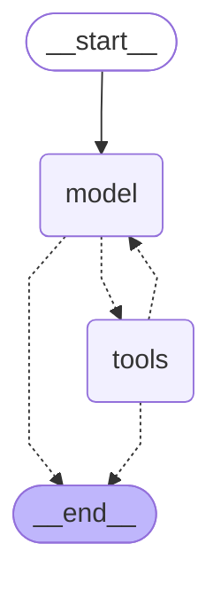

# SPIKE-3 results: plain loop vs. LangGraph

**Date:** 2026-11-15 · **Task:** TESS-37 (T-031) · **Resolves:** O-13 (proposed) · **O-24:** not covered yet (see below)

Both versions run the same agent: same two tools, same scripted model, same trace format. All 14 tests in `test_spike.py` pass on both, including a check that the two produce identical outcomes, histories and traces.

## Measurements

| | plain loop | LangGraph |
|---|---|---|
| Lines of loop code | 31 | 69 |
| Extra packages to install | 0 | 33 |
| Import time (ms, median of 3) | 137 | 560 |
| Time per request, scripted model (ms) | 0.65 | 4.31 |
| Stack frames when the model fails | 4 | 11 |

## Trace of the same request (identical for both)

| step | kind | name | status |
|---|---|---|---|
| 1 | model | query_data | ok |
| 1 | tool | query_data | ok |
| 2 | model | check_clash | ok |
| 2 | tool | check_clash | ok |
| 3 | model | answer | ok |

Outcome: **answered**: Yes: SYN 101 and SYN 102 both meet MWF 09:00.

## What LangGraph gives without extra code

Per-node streaming (`graph.stream(..., stream_mode='updates')`):

- `model` → step 1, query_data
- `tools` → step ·, query_data
- `model` → step 2, check_clash
- `tools` → step ·, check_clash
- `model` → step 3, answer

Diagram (`graph.get_graph().draw_mermaid()`):

## What the numbers mean

- **Traceability: a tie for our needs.** Both record the same spans (step, model/tool, inputs, outputs, status, time), because the trace comes from our own `Span` records, not from the framework. LangGraph adds per-node streaming and a generated diagram for free; the plain loop would need a few lines for streaming, and the diagram is two boxes we can draw by hand. Langfuse works with both: an `@observe()` decorator on a plain loop, or its LangGraph callback (SPIKE-4 checks the non-LLM spans).
- **Testability: a tie.** The same tests, with the same scripted model, cover the normal run, the step limit, tool errors, bad arguments, an unknown tool and the "ask the user" path on both.
- **Cost of LangGraph:** about twice the loop code, 33 extra packages (including `langchain-core`), 4x slower import, more stack frames to read when something fails, and one more library the whole team must learn before the demo. Speed per request does not matter (the LLM and the solver take seconds).
- **What LangGraph would add that we don't use:** pausing mid-run and resuming from a saved checkpoint (`interrupt`), parallel branches and multi-agent graphs. Our design has one agent with a bounded loop (Section 13.2); "ask the user" ends the request and the answer comes back as a new request with the session's working memory; the approval gate lives in the app (proposals in the database, T-064), not inside the loop.

## Proposal for O-13

**Plain Python loop**, built as in `plain_loop.py`: model call, tool call with Pydantic-validated arguments, errors returned to the model as data, a hard step limit, an explicit trace. Revisit if the design gains parallel branches, more than one agent, or a need to pause a run and resume it later.

## O-24 (open)

The ticket asks for "ReAct framing options for O-24". O-24's exact wording is not in the project document v1 or in Jira, so it is left out until the team confirms what it covers.
